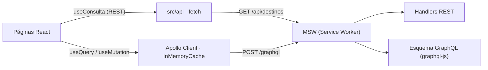
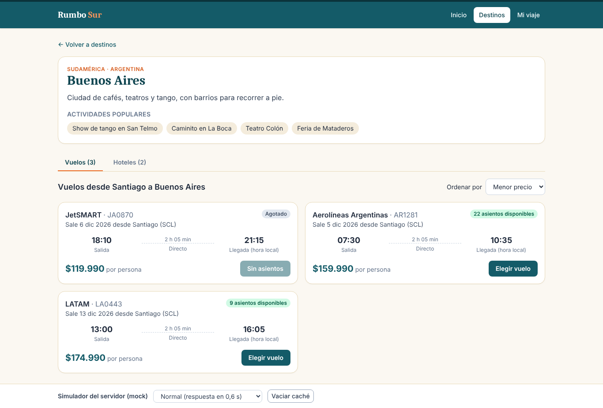
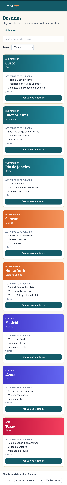
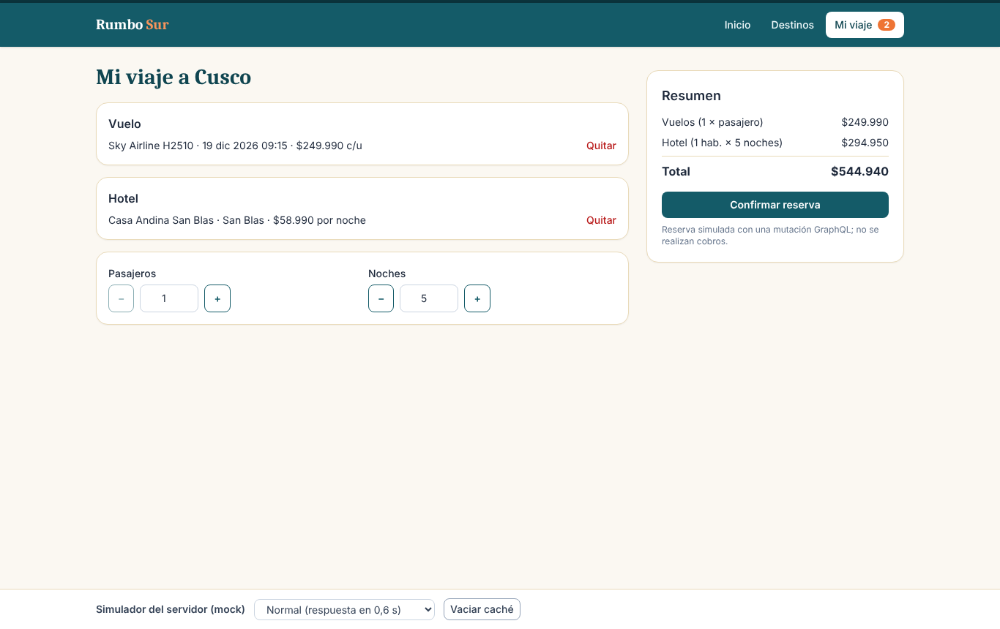
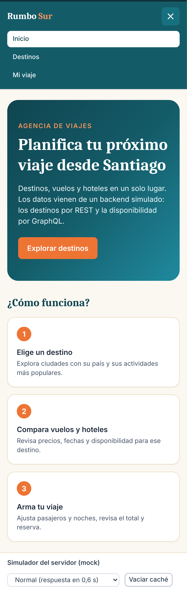
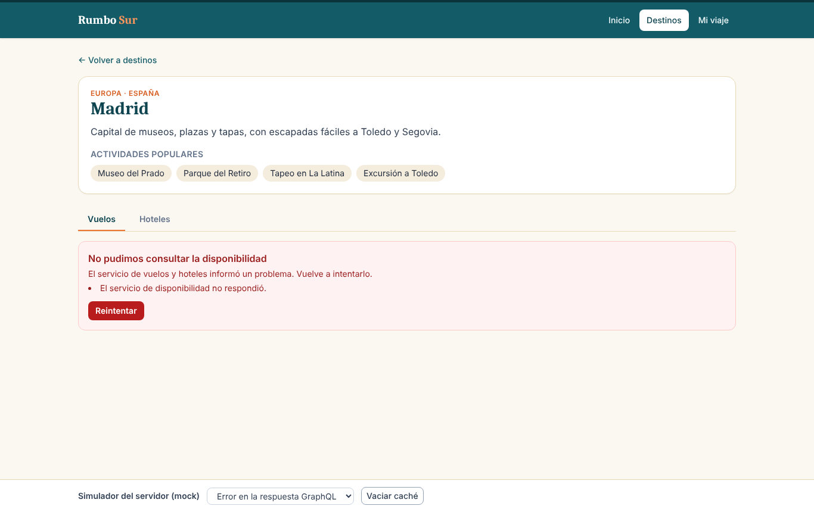
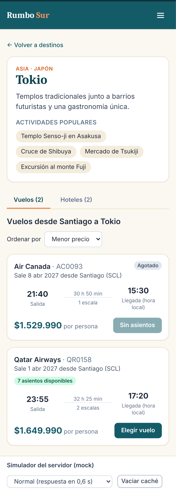
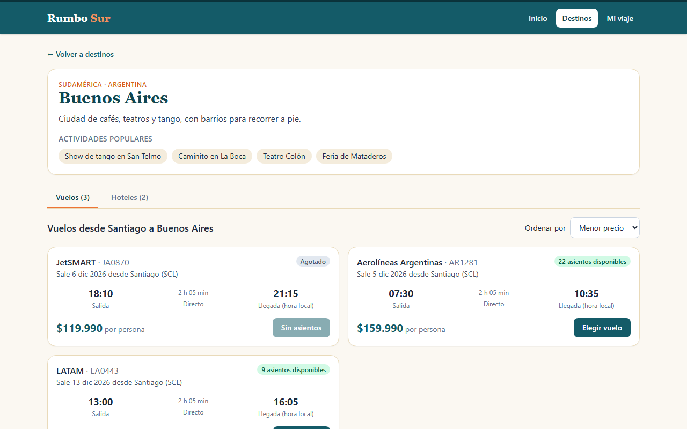
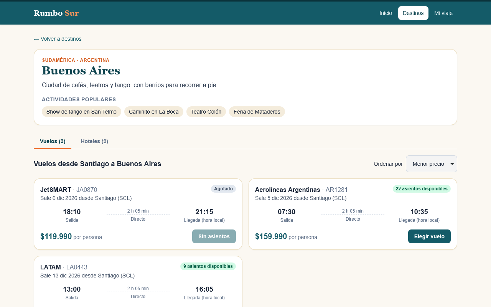
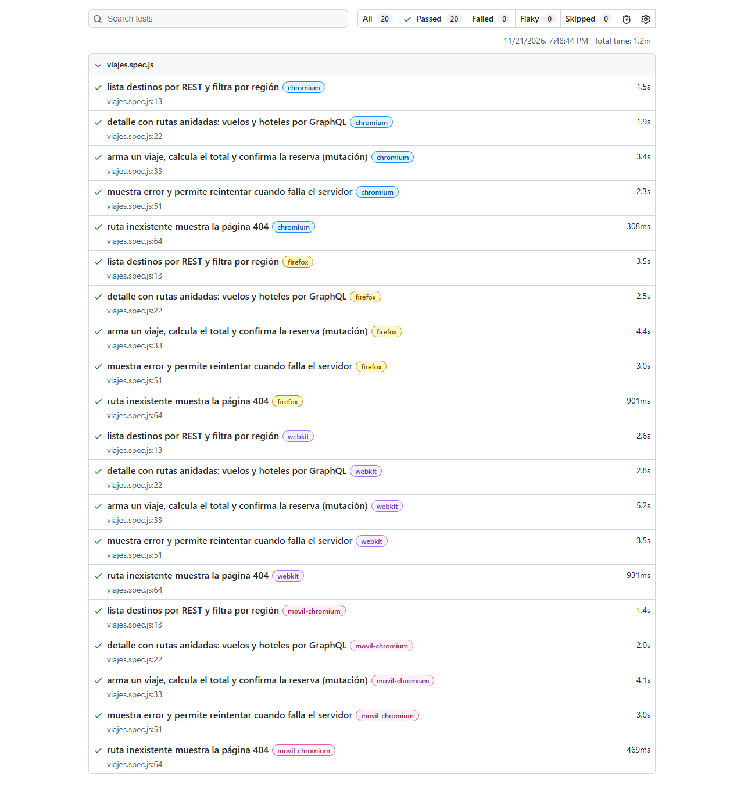

# Rumbo Sur — Agencia de viajes (PFY2202 · Experiencia 2 · Semana 5)

Aplicación web en **React 18 + Vite** para explorar destinos y planificar vuelos y hoteles.
Los datos vienen de un **backend simulado con MSW**: los destinos se consultan por **REST** y la
disponibilidad de vuelos y hoteles por **GraphQL** (Apollo Client). La navegación usa **React Router**
con rutas anidadas y el diseño es responsive con **Tailwind CSS**.

## Requisitos de la actividad y dónde se cumplen

| Requisito                                | Implementación                                                                                                                                                              |
| ---------------------------------------- | ---------------------------------------------------------------------------------------------------------------------------------------------------------------------------- |
| Interfaz responsive (Tailwind)           | `src/index.css`, `tailwind.config.js`; grillas 1/2/3 columnas, menú hamburguesa en móvil (`Navbar.jsx`), capturas en `docs/capturas`                               |
| Consumo de API REST                      | `src/api/` → `GET /api/destinos`, `GET /api/destinos/:id` con `fetch`, timeout, caché y errores tipados                                                            |
| Consumo de API GraphQL                   | `src/apollo/` → query `OpcionesDeViaje` (vuelos + hoteles en una sola petición) y mutaciones `reservarVuelo` / `reservarHotel`                                     |
| React Router                             | `src/App.jsx`: `/`, `/destinos`, `/destinos/:id` con hijas `vuelos` y `hoteles` (`<Outlet>`), `/mi-viaje`, 404                                               |
| Componentes modulares                    | `src/components` (tarjetas, mensajes, carga), `src/pages`, `src/hooks`, `src/context`, `src/utils`                                                                 |
| `useState` y `useEffect`             | `useConsulta.js` (ciclo de vida de la petición REST), `ViajeContext.jsx` (persistencia en `localStorage`), filtros en `Destinos.jsx`, formulario en `MiViaje.jsx` |
| Indicadores de carga y manejo de errores | `BarraProgreso` (peticiones REST y GraphQL en curso), `Cargando`, `MensajeError` con «Reintentar» y datos de respaldo                                                |
| Documentación en GitHub + GitHub Pages  | este README, `docs/`, script `deploy` con `gh-pages`                                                                                                                   |
| Pruebas cross-browser                    | `playwright.config.js` (Chromium, Firefox, WebKit y móvil), resultados en `docs/pruebas-cross-browser.md`                                                               |

## Arquitectura

```
src/
├── api/            # Cliente REST: fetch con timeout, caché con vigencia, errores tipados
├── apollo/         # Cliente Apollo, operaciones GraphQL (fragmentos) y traducción de errores
├── components/     # Componentes de presentación reutilizables
├── context/        # ViajeContext: plan de viaje global (vuelo, hotel, pasajeros, noches)
├── hooks/          # useConsulta: hook REST con useState + useEffect
├── mocks/          # Backend simulado: datos, handlers REST, esquema GraphQL ejecutable, escenarios
├── pages/          # Pantallas asociadas a rutas
└── utils/          # Funciones puras: formato, validación, cálculo del viaje
```



**¿Por qué REST y GraphQL juntos?** La ficha de un destino cambia poco y se cachea por URL (REST).
Los vuelos y hoteles cambian con cada reserva y cada pantalla necesita campos distintos, por eso se
piden con GraphQL: una sola consulta trae ambos listados con exactamente los campos usados por las
tarjetas, y las mutaciones devuelven `id` + cupos para que la caché normalizada de Apollo se actualice
sola.

## API simulada

### REST

| Método | Ruta                  | Respuesta                                          |
| ------- | --------------------- | -------------------------------------------------- |
| GET     | `/api/destinos`     | Lista resumida de destinos (`?region=` opcional) |
| GET     | `/api/destinos/:id` | Ficha completa; `404` si no existe               |

### GraphQL (`POST /graphql`)

```graphql
enum Orden { PRECIO_ASC PRECIO_DESC }

type Query {
  vuelos(destinoId: ID!, orden: Orden = PRECIO_ASC): [Vuelo!]!
  hoteles(destinoId: ID!, estrellasMinimas: Int = 1): [Hotel!]!
  vuelo(id: ID!): Vuelo
  hotel(id: ID!): Hotel
}

type Mutation {
  reservarVuelo(id: ID!, pasajeros: Int!): Vuelo!       # 1 a 9 pasajeros
  reservarHotel(id: ID!, habitaciones: Int!): Hotel!    # 1 a 5 habitaciones
}
```

El esquema se ejecuta de verdad con `graphql-js` dentro del handler de MSW, así que las validaciones
de tipos y los errores de resolvers llegan al cliente en el arreglo `errors`, igual que con un servidor real.

### Simulador del servidor

En el pie de página se puede elegir un escenario para demostrar el manejo de estados:
**Normal**, **Servidor lento (3 s)**, **Error del servidor (HTTP 500)**, **Error en la respuesta
GraphQL** y **Sin conexión**. El botón **Vaciar caché** borra la caché REST y la de Apollo.

## Seguridad

- Ids de ruta validados con lista blanca (`esIdValido`) y codificados con `encodeURIComponent` antes de armar URLs.
- Valores numéricos acotados (`limitarEntero`) en el cliente y validados otra vez en los resolvers.
- No se usa `dangerouslySetInnerHTML`; React escapa todo el texto.
- `localStorage` / `sessionStorage` dentro de `try/catch` y solo para datos no sensibles.
- Build con **Content-Security-Policy** (`vite.config.js`): solo recursos del propio origen. No hay
  scripts ni hojas de estilo de CDN, por lo que no se necesitan atributos SRI. GitHub Pages sirve
  `*.github.io` por HTTPS con HSTS.
- Código de reserva generado con `crypto.getRandomValues` (es un identificador simulado, no un secreto).

## Uso

Requisitos: Node.js 20 o superior.

```bash
npm install
npm run dev          # http://localhost:5173
npm test             # pruebas unitarias (node:test)
npx playwright install   # una vez: descarga Chromium, Firefox y WebKit
npm run test:e2e     # pruebas end-to-end en todos los navegadores
npm run build && npm run preview
```

### Publicar en GitHub Pages

```bash
npm run build
npm run deploy       # sube dist/ a la rama gh-pages
```

Luego, en GitHub → *Settings → Pages*, elegir la rama `gh-pages` como origen.

## Pruebas

- **Unitarias** (`tests/unit`): caché, cálculo del viaje, validaciones y esquema GraphQL (consultas, orden, errores y mutaciones).
- **End-to-end** (`tests/e2e`): listado y filtro REST, rutas anidadas con GraphQL, armado del viaje con mutación, error + reintento y 404.

Resultados y matriz de compatibilidad: [`docs/pruebas-cross-browser.md`](docs/pruebas-cross-browser.md).

| Prueba                                           | Resultado | Evidencia                                                       |
| ------------------------------------------------ | --------- | --------------------------------------------------------------- |
| Unitarias (`npm test`)                         | 15 / 15   | [`docs/resultado-unitarias.txt`](docs/resultado-unitarias.txt) |
| End-to-end en Chromium, Firefox, WebKit y móvil | 20 / 20   | [`docs/resultado-e2e.txt`](docs/resultado-e2e.txt)             |

## Capturas

| Escritorio                                                 | Móvil                                                     |
| ---------------------------------------------------------- | ---------------------------------------------------------- |
|  |  |
|                  |            |
|        |      |

### Pruebas cross-browser

| Chromium                                                                                           | Firefox                                                                                          | WebKit                                                                                         |
| -------------------------------------------------------------------------------------------------- | ------------------------------------------------------------------------------------------------ | ---------------------------------------------------------------------------------------------- |
| 


 | 


 | 


 |


